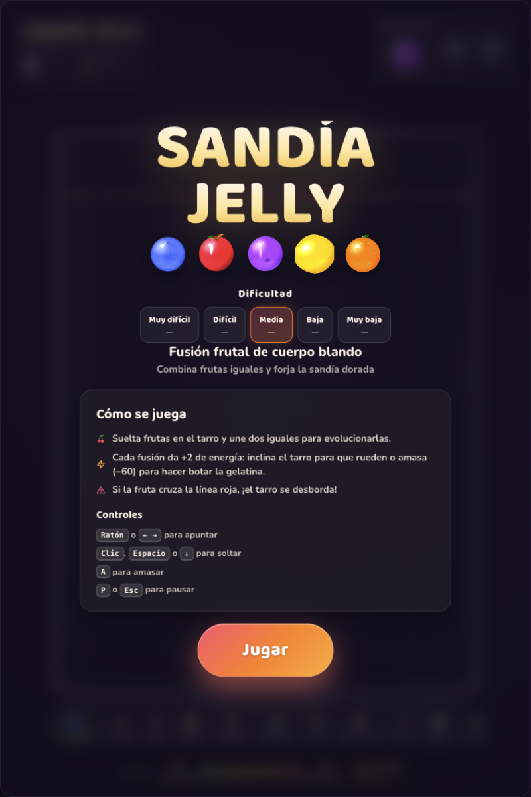
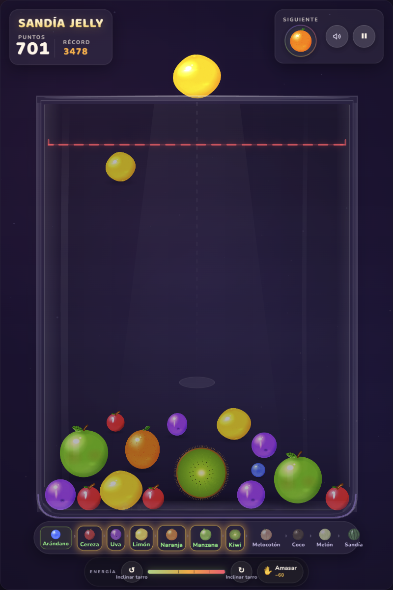
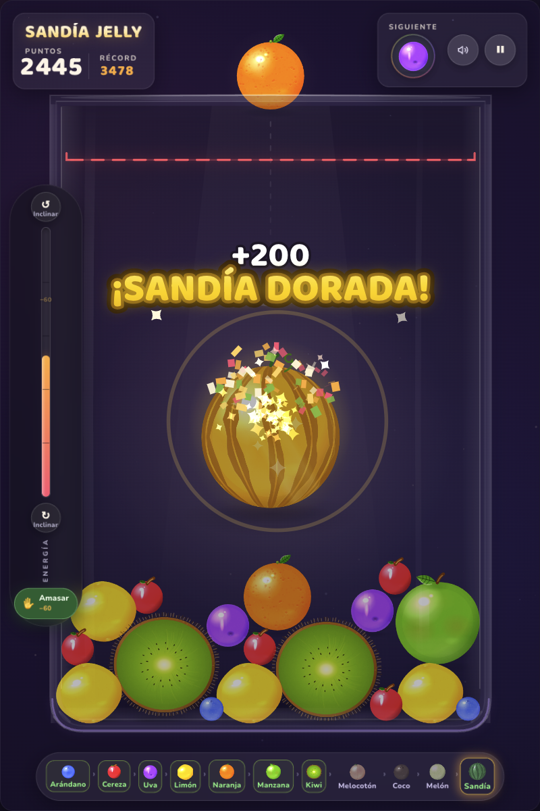

# 🍉 Sandía Jelly · Fusión frutal de cuerpo blando

Juego web del género *suika* (fusión de frutas) con **física de cuerpos blandos**, arte 100 %
procedural en Canvas 2D, audio sintetizado con WebAudio e interfaz en español.
Implementación original: sin assets externos, sin frameworks — solo canvas, Matter.js
(vendorizado) y ganas de zumo.

| Menú | Partida | Clímax dorado |
| --- | --- | --- |
|  |  |  |

Más capturas en `screenshots/` (amasado, récord en vivo, fin de partida…).

## Cómo jugar

Abre el juego con un servidor estático (los módulos ES no funcionan con `file://`):

```bash
cd frutas
python3 -m http.server 8137
# → http://localhost:8137/
```

También existe la tarea `npm start` (usa el mismo puerto).

- **Objetivo**: suelta frutas en el tarro y une dos iguales para evolucionarlas por la
  cadena de 11 especies (arándano → cereza → uva → limón → naranja → manzana → kiwi →
  melocotón → coco → melón → sandía). Dos sandías fusionadas forjan la legendaria
  **sandía dorada** (+200 × combo).
- **Niveles de dificultad**: Muy difícil, Difícil, Media, Baja y Muy baja. La única
  variación es el tamaño de las frutas (−0 % a −20 %) y cada nivel tiene su propio
  récord guardado.
- **Fusión de sandías doradas** (opción del menú, desactivada por defecto): al
  activarla, dos sandías doradas en contacto se funden y **desaparecen** del tablero,
  otorgando la puntuación máxima del juego (600 = la misma proporción ×3 que sigue
  la cadena sandía 66 → dorada 200), multiplicada por el combo.
- **Energía**: cada fusión suma +2. Con ella puedes **inclinar el tarro** (10/s) o
  **amasar la gelatina** (−60), que hace vibrar todo el tarro. La primera vez que juegas,
  una guía contextual junto a la barra lo explica y no vuelve a molestar.
- **Fin de partida**: si una fruta invade la línea roja durante demasiado tiempo, el
  tarro se desborda.
- El récord se guarda en `localStorage`.

## Controles

| Acción            | Entrada                                    |
| ----------------- | ------------------------------------------ |
| Apuntar           | Ratón / dedo o `←` `→`                     |
| Soltar fruta      | Clic / toque, `Espacio`, `Enter` o `↓`     |
| Amasar            | Botón «Amasar» o tecla `A`                 |
| Inclinar el tarro | Botones `↺` `↻` (mantener) o `Q` / `E`     |
| Pausa             | `P` o `Esc` (también al cambiar de pestaña)|
| Sonido            | `M` o botón 🔊                             |
| Reiniciar         | `R` (en pausa o fin de partida)            |

## Arquitectura (un archivo por responsabilidad)

```
index.html              Estructura DOM del escenario y del HUD
css/style.css           Tema noche-violeta, glassmorphism, animaciones
vendor/matter.min.js    matter-js 0.20.0 (MIT), vendorizado
js/
├── config.js           Única fuente de verdad: constantes, cadena de frutas, textos ES
├── main.js             Arranque, escalado responsivo 720×1080, entrada, bucle RAF
├── core/
│   ├── physics.js      Motor Matter: paredes, inclinación de gravedad, detección de pares
│   └── game.js         Máquina de estados, fusiones, combos, energía, peligro, récord
├── entities/
│   ├── fruit.js        Fruta: cuerpo + muelle de gelatina (squash & stretch acotado)
│   └── spawner.js      Cola de aparición uniforme (niveles 1-5) con anti-racha
├── render/
│   ├── textures.js     Texturas procedurales de las 11 frutas (+ dorada), horneadas
│   └── renderer.js     Escena: fondo, tarro de cristal, frutas, guía, peligro, auras
├── effects/
│   ├── particles.js    Zumo, pulpa, chispas, anillos, confeti y polvo (con pooling)
│   └── effects.js      Sacudida de cámara, popups, banner de combo y clímax dorado
├── audio/sound.js      SFX y música ambiental 100 % sintetizados (WebAudio)
└── ui/
    ├── hud.js          Puntos, récord, siguiente, energía, cadena de evolución
    └── overlays.js     Pantallas de inicio, pausa y fin de partida
```

## Detalles de acabado

- **Física blanda percibida**: cuerpos rígidos estables (Matter, 120 Hz con substeps) +
  render con muelles de gelatina, inclinación de la gravedad y olas de amasado.
- **Arte por fruta**: silueta orgánica con ruido sembrado, subsurface, doble especular
  aditivo, grano y decorado propio por especie (pruina, ombligo, poros, retícula,
  corteza felpuda, kiwi cortado…). Directriz de viveza validada en comparaciones ciegas.
- **Juice**: zumo con núcleo blanco clipeado al cristal, anillos de grosor variable,
  sacudida con trauma, cámara lenta en el clímax dorado, popups con muelle.
- **Audio**: plops con pitch-bend ligado al tier y al combo, latido de peligro,
  fanfarria FM dorada y música pentatónica con delay — todo sintetizado.
- **Accesible**: `focus-visible`, `aria-*` en energía, `prefers-reduced-motion`,
  contraste AA en los estados críticos y pausa automática al ocultar la pestaña.

## Modo QA / capturas

`?demo=1` lanza una partida automática con guion (útil para capturas y pruebas).
El gancho `window.__game` expone el estado para depurar (`debugAdd`, `debugGameOver`, …).
